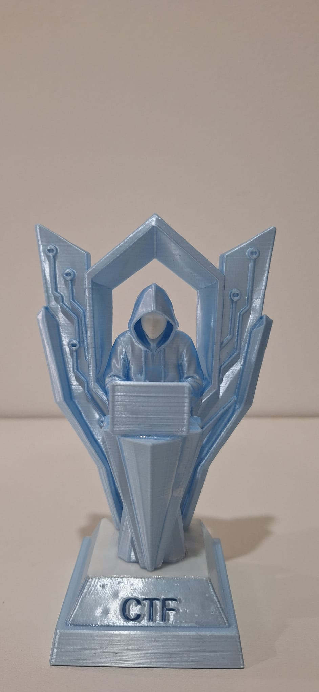
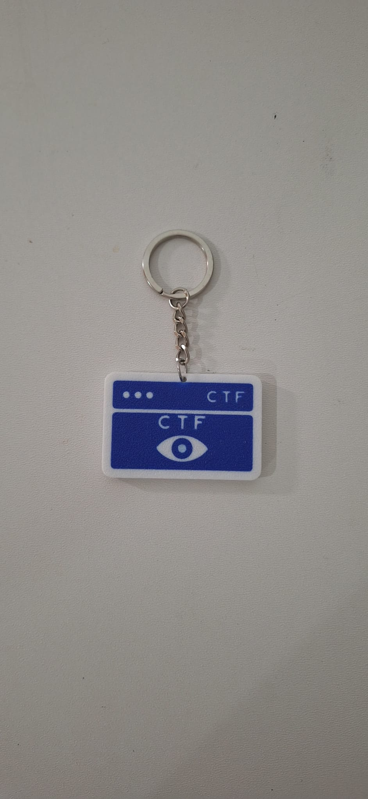
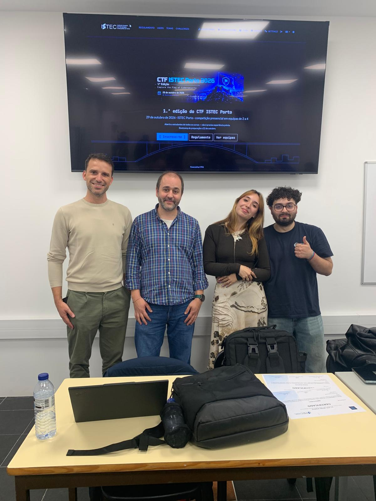
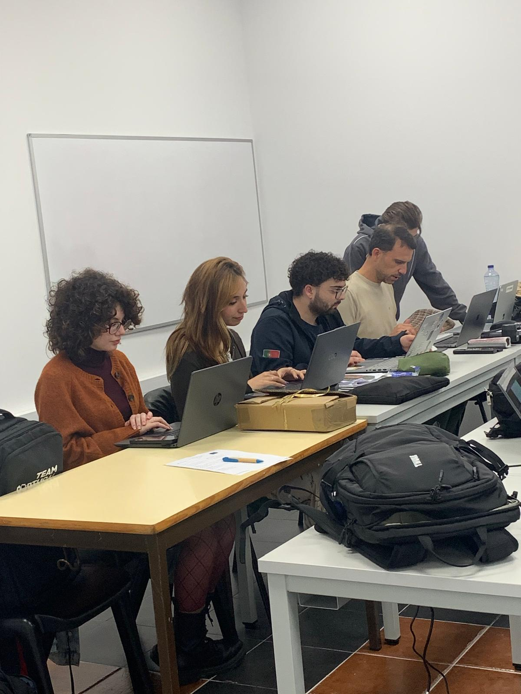
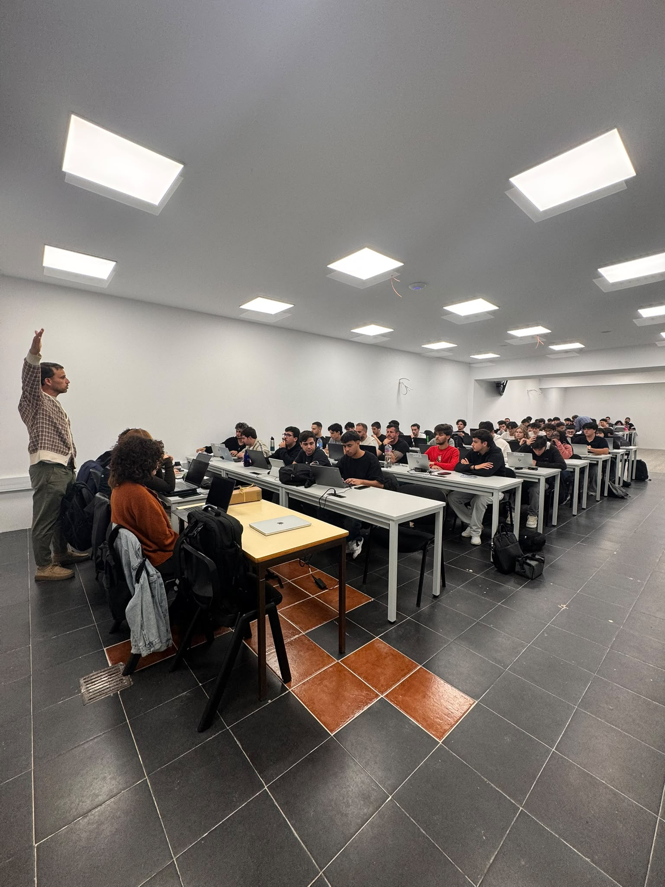
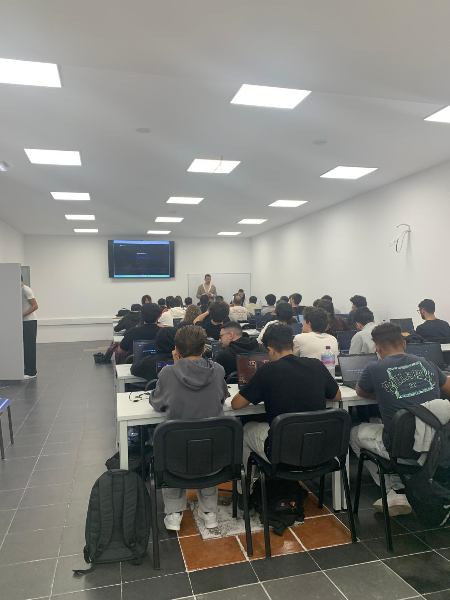
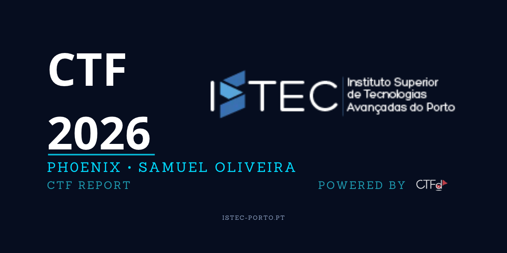

# CTF ISTEC Porto 2026: 1st Edition: Capture the Flag of Cybersecurity

## Overview

Personal account of my participation in the **organisation** of the 1st edition of the **CTF ISTEC Porto | Capture the Flag of Cybersecurity**, a hands-on, jeopardy-style cybersecurity competition promoted by the [**ISTEC Porto: Instituto Superior de Tecnologias Avançadas do Porto**](https://istec-porto.pt).

The event ran over two dates: a **preparation session (bootcamp) on 22 October 2026**, and the **competition itself on 29 October 2026**, at the ISTEC Porto premises. On competition day, **22 teams** of 2 to 4 students competed against each other to solve **43 challenges** worth a combined **8100 points**, on a self-hosted [CTFd](https://ctfd.io) platform.

This repository gathers my full participation report (Portuguese and English), a photo and video record of the event, and the competition statistics and results.

## Scope

This is a first-person, documentary account of my role as a member of the organising team, contributing to the conception, preparation and running of the event. It covers the format and rules, the preparation bootcamp, competition day, the platform statistics and final leaderboard, the podium and awards, and a critical analysis with recommendations for future editions.

The report was written by **José Samuel Oliveira** (Ph0enix) and is published for portfolio and documentation purposes. It does not disclose challenge solutions, flags, or any restricted material.

## Event at a Glance

| Item        | Detail                                                                    |
| ----------- | ------------------------------------------------------------------------- |
| Event       | CTF ISTEC Porto: Capture the Flag of Cybersecurity (1st edition)        |
| Promoter    | ISTEC Porto: Instituto Superior de Tecnologias Avançadas do Porto      |
| Format      | Jeopardy (CTFd platform), flags in the `ISTEC{...}` format              |
| Bootcamp    | 22 October 2026 (optional preparation session)                            |
| Competition | 29 October 2026 · accreditation 1:30 p.m. · competition 2:15–5:15 p.m. |
| Teams       | 2 to 4 students per team                                                  |
| My role     | Organiser (conception, preparation and running of the event)              |

## Statistics Summary

| Metric           | Value                                |
| ---------------- | ------------------------------------ |
| Registered users | 88                                   |
| Teams (platform) | 26                                   |
| Scoring teams    | 22                                   |
| Distinct IPs     | 265                                  |
| Challenges       | 43                                   |
| Total points     | 8100                                 |
| Flag submissions | 2028 (379 correct · 1649 incorrect) |
| Most-solved      | *Lê as Regras* (22 solves)        |
| Least-solved     | *Ecos of the Past (2/3)* (1 solve) |

## Challenge Categories

| Category               | Challenges   | Points         |
| ---------------------- | ------------ | -------------- |
| Web                    | 18           | 3500           |
| OSINT                  | 7            | 1500           |
| Misc                   | 6            | 700            |
| Cryptography           | 4            | 500            |
| Forensics              | 3            | 700            |
| Reverse                | 2            | 700            |
| CTI                    | 1            | 300            |
| Beginner (Iniciação) | 1            | 100            |
| Programming / Logic    | 1            | 100            |
| **Total**        | **43** | **8100** |

## Final Podium

| Place  | Team                 | Score |
| ------ | -------------------- | ----- |
| 🥇 1st | Marrocos             | 4900  |
| 🥈 2nd | Ciberpunks           | 4000  |
| 🥉 3rd | Gondomar Sport Clube | 3800  |

A **"Rookie" prize**, consisting of an FNAC voucher, was awarded to the best-placed eligible team made up of first-year students and/or students from courses outside the IT field.

### Winning team: Marrocos

- Gonçalo Manuel Albuquerque Marinho: [LinkedIn](https://www.linkedin.com/in/gon%C3%A7alo-manuel-albuquerque-marinho-aa058a284/)
- Filipe Calatré: [LinkedIn](https://www.linkedin.com/in/filipe-calatr%C3%A9-973343395/)
- Bruno Lamela: [LinkedIn](https://www.linkedin.com/in/bruno-lamela-b84746335/)
- Luiz Peneda: no LinkedIn

## Organising Team

| Member                          | Role                       | Link                                                                |
| ------------------------------- | -------------------------- | ------------------------------------------------------------------- |
| Mário Amorim                   | Coordination (lecturer)    | [LinkedIn](https://www.linkedin.com/in/marioamorim/)                |
| Nuno Fonseca                    | Co-organisation (lecturer) | [LinkedIn](https://www.linkedin.com/in/nuno-fonseca-33b2452/)        |
| Vanina Kollen                   | Organisation (student)     | [LinkedIn](https://www.linkedin.com/in/vanina-kollen-337762397/)     |
| Ana Rita Monteiro               | Organisation (student)     | [LinkedIn](https://www.linkedin.com/in/ana-rita-monteiro-b186a8359/) |
| Rafael Batista                  | Organisation (student)     | [LinkedIn](https://www.linkedin.com/in/0xadamastor/)                 |
| José Samuel Oliveira (Ph0enix) | Organisation (student)     | [LinkedIn](https://www.linkedin.com/in/jose-samuel-oliveira/)        |

## Photo Gallery

Selected photos from the event: the competition trophy and keychain keepsake, the organising team, and participants in action.

<table>
  <tr>
    <td></td>
    <td></td>
  </tr>
  <tr>
    <td align="center">Competition trophy</td>
    <td align="center">Event keychain keepsake</td>
  </tr>
  <tr>
    <td></td>
    <td></td>
  </tr>
  <tr>
    <td align="center">Organising team</td>
    <td align="center">Organising team</td>
  </tr>
  <tr>
    <td></td>
    <td></td>
  </tr>
  <tr>
    <td align="center">Participants in action</td>
    <td align="center">Participants in action</td>
  </tr>
</table>

## Disclaimer

This repository is a personal, documentary account of participation in the organisation of an educational cybersecurity event. It does not contain challenge solutions, flags, writeups, or any restricted or confidential material. All opinions expressed are my own.

## Contact

- **Email:** sam.oliveira.dev@gmail.com
- **LinkedIn:** [linkedin.com/in/jose-samuel-oliveira](https://www.linkedin.com/in/jose-samuel-oliveira)
- **GitHub:** [github.com/Sam-Ciber-Dev](https://github.com/Sam-Ciber-Dev)
- **Website:** [sam-ciber-dev.github.io](https://sam-ciber-dev.github.io)

## License

This repository is licensed under [CC BY-NC-ND 4.0](LICENSE). You may share the material with attribution, but not for commercial use or derivative works. See [LICENSE](LICENSE) for details.

## Social Preview

The social preview image used for link cards:

## Badges

